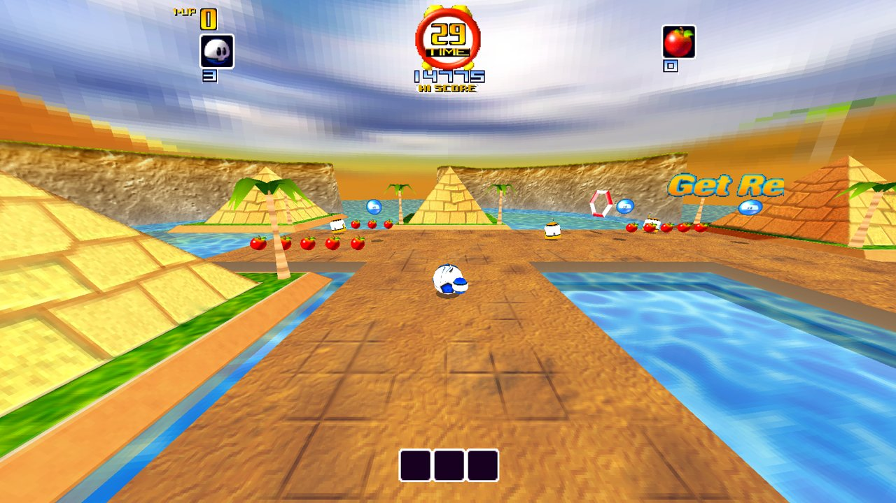
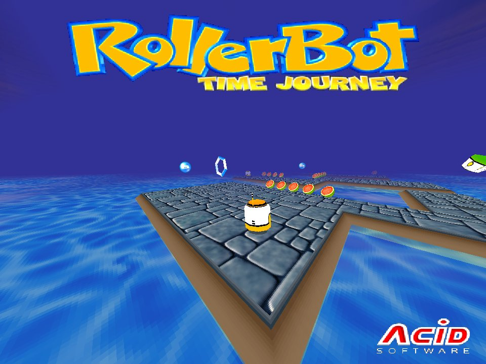
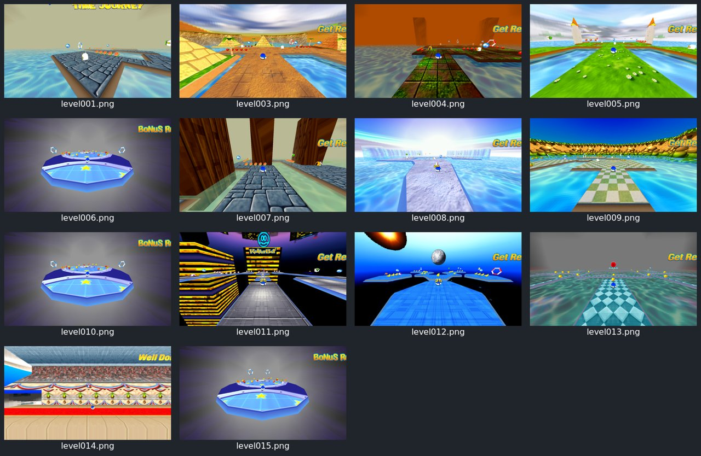

# Rollerbot: A Time Journey: Android / Flatpak port

A fan reconstruction of *Rollerbot: A Time Journey* (2000, 3D Rad engine) for the AYN Thor (dual screen,
gamepad) and Linux (Flatpak). Original code only: no game files, art or decompiled code are in this repo.

**Legal:** bring your own disc. You must own the game; the app imports it from your own copy (a zip or a
folder of its files). Not affiliated with or endorsed by the rights holders.

## Status

**About 55% (October 2026).** The game runs from your own disc's data in this rebuild:

- All 14 levels load and run (title, 10 worlds, bonus rounds, the finale), with the original sky, fog,
  textures and HUD (score, lives, timer, hi-score, apples).
- Gameplay from the original scripts: rolling, pickups, enemies, lives, level exits carrying score and lives on.
- Widescreen modes for 16:9 (Fill, Side panels, Stretch, Off); the HUD stays whole in each.
- Android APK for the AYN Thor: imports straight from your disc (EN/FR/DE/ES/IT), gamepad, bottom-screen
  panel (status, level select, settings), pauses when the lid closes. Not yet tested on a device.
- Linux Flatpak builds and runs.

- High score and progress persist between sessions; pause menu (Esc / Start): resume, restart, level, screen, quit.
- New code-drawn Android launcher and bottom-screen panel (docs/launcher.md).

Next: device testing on the Thor and full playthroughs of every level.



| Title | Every level |
|---|---|
|  |  |

## Build (desktop)

```sh
cmake -S . -B build && cmake --build build -j8 && ctest --test-dir build
RB_DATA=/path/to/game ./build/src/platform/rollerbot   # the game (test pattern without RB_DATA); Esc opens the pause menu
```

Needs SDL2 and GLES2 dev packages. Environment: `RB_WIDESCREEN=fill|panels|stretch|off`, `RB_FULLSCREEN=1`,
`RB_SIZE=1280x720`, `RB_FRAMES=N` (exit after N frames), `RB_SHOT=out.png` (screenshot of the last frame),
`RB_DATA=<game folder>`, `RB_SAVE=<save folder>` (default `~/.local/share/rollerbot`, or `$XDG_DATA_HOME/rollerbot`), `RB_CONTINUE=1`, `RB_LEVEL=level005`. Headless: `RB_SHOT=s.png xvfb-run -a ./build/src/platform/rollerbot`.

## Build (Android APK)

```sh
bash fetch-deps.sh                 # pinned SDL2 source + its Java glue
cd android && ./gradlew assembleDebug
```

Needs JDK 17, Android SDK 34, NDK 26.3 and CMake 3.22. App id `io.github.sirbilliams.rollerbot`. A push to
`main` builds the APK and publishes it as the `latest` release (`.github/workflows/build.yml`, which also builds
and tests the desktop version).

## Getting the game in (bring your own disc)

The Android launcher imports straight from your disc: pick the CD folder (or its Setup files), a CD image
(`roller.iso`, or the raw `roller.bin`), or a `.zip` / folder of an already-installed game. The disc's InstallShield
cabinet is read with unshield (MIT) and the `CodeAndData(<language>)` set you choose (EN/FR/DE/ES/IT) is
extracted into app storage. On desktop, `build/src/platform/rb_import <disc folder|image> <dest> [language]` does
the same (needs `bash fetch-deps.sh` first).

On the AYN Thor the bottom screen shows a companion panel: status (level, lives, fruit, points, pause/resume), a
level select and settings (widescreen, controls).

## Flatpak

`packaging/flatpak/io.github.sirbilliams.Rollerbot.yml`: see the comment at the top. On first run the launcher asks
for your game folder (the one with `Rollerbot.exe`) and copies it to the app's data folder.

## Layout

`src/platform` window, loop, input, layout, screenshots (`rb::Platform`, `rb::Game`) · `src/assets`, `src/scene`,
`src/brain`, `src/audio`, `src/ui` (other lanes, added automatically when they have a `CMakeLists.txt`) ·
`android/` Gradle app (launcher, game activity, bottom-screen companion, lid suspend hook) · `packaging/flatpak`.
